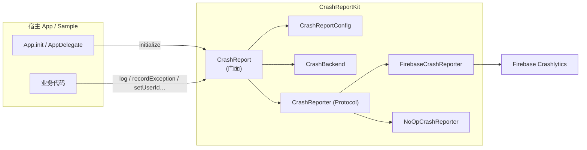
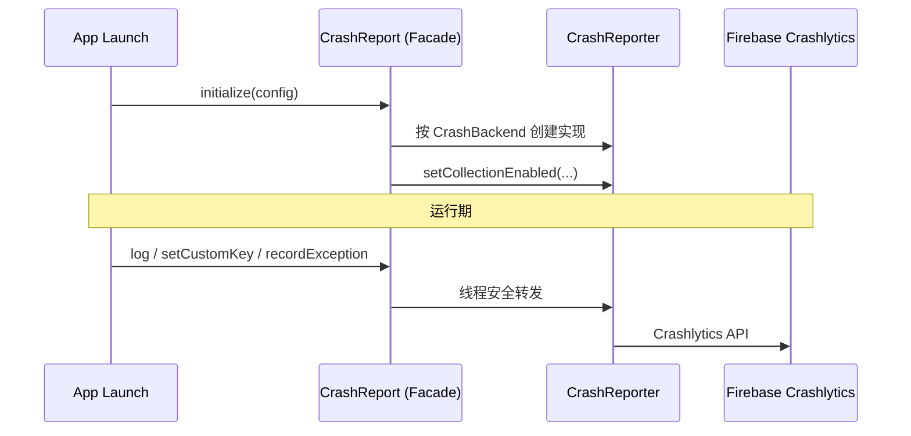

# CrashReportKit (iOS)

> **分支说明**：当前分支为 **`ios`** 分支，提供 iOS / Apple 平台 SDK (Swift) 及示例工程。<br/>
> 🌐 **多平台架构总览与导航门户** 请见 [main 分支](../../tree/main) ｜ 🤖 **Android 实现** 请见 [android 分支](../../tree/android)

iOS 崩溃上报 SDK。业务侧只依赖统一门面 `CrashReport`，底层上报通道可替换。当前临时接入 **Firebase Crashlytics**。

| 模块 | 说明 |
|------|------|
| `CrashReportKit` | SDK 核心库（对外 API + Firebase 适配器 + NoOp 兜底） |
| `Sample` | SwiftUI 演示 App（初始化、breadcrumb、非致命/致命崩溃） |

- **平台要求**：iOS 14.0+ · macOS 11.0+ · tvOS 14.0+ · watchOS 7.0+
- **语言标准**：Swift 5.9+
- **包管理**：Swift Package Manager (SPM) & CocoaPods

---

## 架构

### 模块关系



### 调用链路



### 源码结构

```text
Sources/CrashReportKit/
├── CrashReport.swift            # 对外门面（唯一推荐依赖）
├── CrashReportConfig.swift      # 初始化配置
├── CrashBackend.swift           # 后端枚举（当前仅 firebase）
├── CrashReporter.swift          # 后端契约协议 (Protocol)
└── Internal/
    ├── FirebaseCrashReporter.swift  # Firebase 适配（临时）
    └── NoOpCrashReporter.swift      # 关闭采集 / 未初始化兜底
```

设计要点：

1. **门面隔离**：业务层只调用 `CrashReport.*`，严禁在业务中直接引用 `FirebaseCrashlytics`。
2. **可插拔后端**：新增厂商时仅需实现 `CrashReporter` 协议，并在 `CrashBackend` 中增加枚举项。
3. **安全与降级**：`CrashReportConfig(enabled: false)` 或未初始化前所有调用自动路由至 `NoOpCrashReporter`，保证主流程永不因监控异常崩溃。
4. **并发安全**：门面内部基于轻量互斥锁保证多线程高频调用安全。

---

## 快速开始

### 1. 引入依赖

#### 方式 A：Swift Package Manager (推荐)

在 Xcode 的 `Package Dependencies` 中添加：

```text
https://github.com/e-hai/CrashReportKit.git
分支：ios (或对应 Tag)
```

或在 `Package.swift` 中声明：

```swift
dependencies: [
    .package(url: "https://github.com/e-hai/CrashReportKit.git", branch: "ios")
]
```

#### 方式 B：CocoaPods

在 `Podfile` 中添加：

```ruby
pod 'CrashReportKit', :git => 'https://github.com/e-hai/CrashReportKit.git', :branch => 'ios'
# 若需启用 Firebase 后端并由 Podfile 统一拉取依赖：
pod 'CrashReportKit/Firebase', :git => 'https://github.com/e-hai/CrashReportKit.git', :branch => 'ios'
```

---

### 2. 初始化

在 App 启动入口（SwiftUI 的 `App.init` 或 UIKit 的 `application(_:didFinishLaunchingWithOptions:)`）调用：

```swift
import CrashReportKit

#if canImport(FirebaseCore)
import FirebaseCore
#endif

// 1. 若使用 Firebase 后端，先配置 Firebase
#if canImport(FirebaseCore)
FirebaseApp.configure()
#endif

// 2. 初始化 CrashReportKit
CrashReport.initialize(
    config: CrashReportConfig(
        enabled: true,             // 主开关（false 时全调用 no-op）
        collectionEnabled: true,   // 是否上报（可随用户隐私同意状态切换）
        backend: .firebase
    )
)
```

---

### 3. 业务调用

全工程只 import `CrashReportKit`：

```swift
import CrashReportKit

// 设置用户标识
CrashReport.setUserId("user_10086")

// 设置自定义维度键值
CrashReport.setCustomKey("vip_level", value: "gold")
CrashReport.setCustomKey("login_count", value: 3)
CrashReport.setCustomKey("is_guest", value: false)

// 记录面包屑日志
CrashReport.log("User tapped checkout button")

// 记录非致命异常
do {
    try paymentService.process()
} catch {
    CrashReport.recordException(error)
}

// 模拟致命崩溃（仅用于调试与 QA 验证）
// CrashReport.testCrash()
```

---

### 4. 宿主 App Firebase Crashlytics 配置要求

若使用 `CrashBackend.firebase`：

1. 在 [Firebase Console](https://console.firebase.google.com/) 下载 `GoogleService-Info.plist` 并加入 Xcode 工程主 Target。
2. 宿主工程 Targets -> Build Phases 添加 Run Script 用于上传 dSYM：
   ```sh
   "${BUILD_DIR%Build/*}SourcePackages/checkouts/firebase-ios-sdk/Crashlytics/run"
   ```
   Input Files：
   - `$(DWARF_DSYM_FOLDER_PATH)/$(DWARF_DSYM_FILE_NAME)`
   - `$(DWARF_DSYM_FOLDER_PATH)/$(DWARF_DSYM_FILE_NAME)/Contents/Resources/DWARF/$(TARGET_NAME)`
   - `$(DWARF_DSYM_FOLDER_PATH)/$(DWARF_DSYM_FILE_NAME)/Contents/Info.plist`
   - `$(BUILT_PRODUCTS_DIR)/$(TARGET_NAME).app/$(TARGET_NAME)`
   - `$(BUILT_PRODUCTS_DIR)/$(TARGET_NAME).app/GoogleService-Info.plist`

---

## 换 / 加上报厂商

1. 在 `Sources/CrashReportKit/Internal/` 新增 `XxxCrashReporter.swift : CrashReporter`。
2. 在 `CrashBackend` 枚举中添加新成员（如 `case sentry`）。
3. 在 `CrashReport.initialize` 的 `switch` 中实例化对应适配器。
4. **业务层代码完全无需改动**。

---

## 本地开发与测试

```bash
# 运行单元测试
swift test

# 构建 Package 产物
swift build
```
