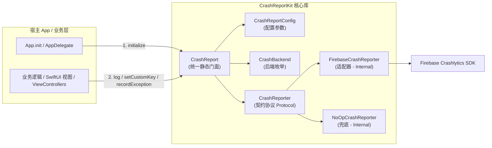
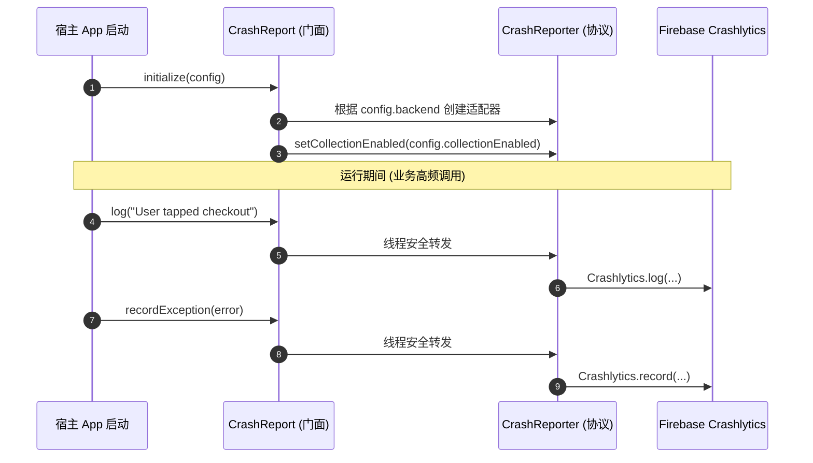

# CrashReportKit-iOS

[](https://swift.org)
[](https://developer.apple.com)
[](https://swift.org/package-manager/)
[](https://cocoapods.org)
[](LICENSE)

> **轻量级、模块化、无厂商绑定的 iOS / Apple 全平台统一崩溃上报 SDK 门面。**  
> 业务层只依赖单一门面 `CrashReport`，底层厂商通道可热插拔替换（当前默认接入 **Firebase Crashlytics**）。  
> 🤖 **Android 版本**：请访问 [CrashReportKit-Android](https://github.com/e-hai/CrashReportKit-Android)。

---

## 🌟 核心特性

- **统一门面模式（Unified Facade）**：全业务工程只依赖 `CrashReport`，避免业务代码散落对具体厂商（如 Firebase）的硬编码引用。
- **零厂商类型泄漏（Zero Vendor Leakage）**：底层适配器均置于 `internal` 作用域，不暴露任何第三方库类型。更换上报平台（如切换至 Sentry 或自研系统）时业务层**零改动**。
- **隐私合规与动态控制（Privacy & Compliance by Design）**：提供 `setCollectionEnabled` 运行时开关，完美支持 GDPR / PIPL 合规要求，未取得用户同意前停止上传。
- **双重安全降级（Fail-Safe & Dual No-Op）**：未初始化状态或主动配置 `enabled = false` 时自动路由到 `NoOpCrashReporter`，监控 SDK 绝不反噬主应用流程。
- **严格线程安全与并发保护**：门面内部基于轻量互斥锁（`NSLock`）与 Swift `Sendable` 保证多线程并发读写安全。
- **多平台广泛支持**：同时支持 iOS 14.0+、macOS 11.0+、tvOS 14.0+ 与 watchOS 7.0+。

---

## 🏗️ 架构设计

### 模块结构与调用关系



### 运行时时序



---

## 📦 接入依赖

### 方式 1：Swift Package Manager (推荐)

在 Xcode 中点击 **File -> Add Package Dependencies...**，输入仓库地址：

```text
https://github.com/e-hai/CrashReportKit-iOS.git
```
- **Dependency Rule**：选择 **Up to Next Major Version**，填入 `1.0.0`。

或在您工程的 `Package.swift` 中声明：

```swift
dependencies: [
    .package(url: "https://github.com/e-hai/CrashReportKit-iOS.git", from: "1.0.0")
],
targets: [
    .target(
        name: "YourApp",
        dependencies: [
            .product(name: "CrashReportKit", package: "CrashReportKit-iOS")
        ]
    )
]
```

---

### 方式 2：CocoaPods

在 `Podfile` 中添加：

```ruby
# 引入基础库（仅门面与契约）
pod 'CrashReportKit', :git => 'https://github.com/e-hai/CrashReportKit-iOS.git', :tag => '1.0.0'

# 若需同时拉取 FirebaseCrashlytics 官方依赖：
pod 'CrashReportKit/Firebase', :git => 'https://github.com/e-hai/CrashReportKit-iOS.git', :tag => '1.0.0'
```

然后执行：
```bash
pod install
```

---

## 🚀 初始化与使用

### 1. 初始化

#### SwiftUI 应用入口：
```swift
import SwiftUI
import CrashReportKit

#if canImport(FirebaseCore)
import FirebaseCore
#endif

@main
struct MyApp: App {

    init() {
        // 1. 若使用 Firebase 后端且存在配置文件，先配置 Firebase
        #if canImport(FirebaseCore)
        FirebaseApp.configure()
        #endif

        // 2. 初始化 CrashReportKit
        CrashReport.initialize(
            config: CrashReportConfig(
                enabled: true,             // 主开关（false 时所有调用走 NoOp）
                collectionEnabled: true,   // 采集开关（可根据隐私合规授权动态切换）
                backend: .firebase
            )
        )

        // 3. 设置全局通用用户上下文
        CrashReport.setUserId("user_10086")
        CrashReport.setCustomKey("app_flavor", value: "production")
        CrashReport.setCustomKey("channel", value: "app_store")
    }

    var body: some Scene {
        WindowGroup {
            ContentView()
        }
    }
}
```

#### UIKit / AppDelegate 入口：
```swift
import UIKit
import CrashReportKit
#if canImport(FirebaseCore)
import FirebaseCore
#endif

@main
class AppDelegate: UIResponder, UIApplicationDelegate {

    func application(
        _ application: UIApplication,
        didFinishLaunchingWithOptions launchOptions: [UIApplication.LaunchOptionsKey: Any]?
    ) -> Bool {
        #if canImport(FirebaseCore)
        FirebaseApp.configure()
        #endif

        CrashReport.initialize(
            config: CrashReportConfig(
                enabled: true,
                collectionEnabled: true,
                backend: .firebase
            )
        )
        return true
    }
}
```

---

### 2. 业务日常调用

在整个业务代码中，只需 `import CrashReportKit`：

```swift
import CrashReportKit

// 1. 记录面包屑日志（随崩溃报告一同上传，用于操作行为回放）
CrashReport.log("User clicked [Pay] button on CheckoutView")

// 2. 设置自定义维度键值（支持 String, Bool, Int, Int64, Float, Double）
CrashReport.setCustomKey("vip_level", value: "gold")
CrashReport.setCustomKey("retry_count", value: 3)
CrashReport.setCustomKey("is_guest", value: false)
CrashReport.setCustomKey("exchange_rate", value: 7.23)

// 3. 记录捕获的非致命异常（不杀进程，聚合到控制台）
do {
    try orderNetworkService.submitOrder()
} catch {
    CrashReport.recordException(error)
}

// 4. 动态切换隐私合规采集状态（用户撤销数据分析授权时关闭）
CrashReport.setCollectionEnabled(false)

// 5. 触发测试致命崩溃（仅用于本地调试与 QA 验证 dSYM 符号解析）
// CrashReport.testCrash()
```

---

### 3. 配置 Firebase 凭据与 dSYM 上传（针对 Firebase 后端）

若使用 `CrashBackend.firebase`：

1. 在 [Firebase 控制台](https://console.firebase.google.com/) 下载 `GoogleService-Info.plist`，并将其添加到宿主工程的主 Target。
2. 符号表自动上传：在 Xcode 的主 Target -> **Build Phases** -> 点击 **+** -> **New Run Script Phase**：
   ```sh
   "${BUILD_DIR%Build/*}SourcePackages/checkouts/firebase-ios-sdk/Crashlytics/run"
   ```
   **Input Files** 中添加：
   - `$(DWARF_DSYM_FOLDER_PATH)/$(DWARF_DSYM_FILE_NAME)`
   - `$(DWARF_DSYM_FOLDER_PATH)/$(DWARF_DSYM_FILE_NAME)/Contents/Resources/DWARF/$(TARGET_NAME)`
   - `$(DWARF_DSYM_FOLDER_PATH)/$(DWARF_DSYM_FILE_NAME)/Contents/Info.plist`
   - `$(BUILT_PRODUCTS_DIR)/$(TARGET_NAME).app/$(TARGET_NAME)`
   - `$(BUILT_PRODUCTS_DIR)/$(TARGET_NAME).app/GoogleService-Info.plist`

---

## 📋 API 详细参考

| 方法签名 | 说明 | 适用场景 |
|:---|:---|:---|
| `initialize(config: CrashReportConfig)` | 初始化 SDK 门面 | 应用启动生命周期 |
| `isInitialized() -> Bool` | 检查门面是否已完成初始化 | 运行时检查 |
| `setCollectionEnabled(_ enabled: Bool)` | 动态控制是否允许向远程上报数据 | GDPR / 隐私政策合规状态同步 |
| `setUserId(_ userId: String?)` | 绑定会话关联的用户唯一标识（传 nil 解绑） | 用户登录/退出登录 |
| `setCustomKey(_ key: String, value: String)` | 设置自定义元数据键值（字符串） | 维度追踪 |
| `setCustomKey(_ key: String, value: Bool)` | 设置自定义元数据键值（布尔） | 特性开关状态 |
| `setCustomKey(_ key: String, value: Int/Int64)` | 设置自定义元数据键值（整型/长整型） | 计数器、错误码 |
| `setCustomKey(_ key: String, value: Float/Double)`| 设置自定义元数据键值（浮点数） | 金额、比率、耗时 |
| `log(_ message: String)` | 记录行内操作面包屑日志 | 关键用户轨迹追踪 |
| `recordException(_ error: Error)` | 捕获并上报非致命 Swift `Error` / `NSError` | 业务 `do-catch` 兜底 |
| `testCrash() -> Never` | 强制调用 `fatalError` 触发致命崩溃 | 验证符号表解析（仅 Debug） |
| `setReporter(_ customReporter: CrashReporter)`| 注入自定义上报器实现 | 单元测试打桩或扩展自研后端 |

---

## 🔌 扩展与自定义上报后端

如果未来需要替换为其他 APM 平台（如 **Sentry** 或 **自研监控**）：

1. 实现 `CrashReporter` 协议：
   ```swift
   final class SentryCrashReporter: CrashReporter, @unchecked Sendable {
       func setCollectionEnabled(_ enabled: Bool) { /* Sentry SDK 开关 */ }
       func setUserId(_ userId: String?) { /* 设置 Sentry User */ }
       func setCustomKey(_ key: String, value: String) { /* 设置 Sentry Tag/Extra */ }
       func setCustomKey(_ key: String, value: Bool) { /* ... */ }
       func setCustomKey(_ key: String, value: Int) { /* ... */ }
       func setCustomKey(_ key: String, value: Int64) { /* ... */ }
       func setCustomKey(_ key: String, value: Float) { /* ... */ }
       func setCustomKey(_ key: String, value: Double) { /* ... */ }
       func log(_ message: String) { /* Sentry.addBreadcrumb(...) */ }
       func recordException(_ error: Error) { /* Sentry.capture(error: error) */ }
   }
   ```
2. 注入到门面中：
   ```swift
   CrashReport.setReporter(SentryCrashReporter())
   ```
3. **全工程所有业务代码完全不需要修改**。

---

## 📱 运行 Demo 示例工程

本项目自带完整的可运行演示工程 `CrashReportKitDemo`：

```bash
# 进入工程目录并一键用 Xcode 打开
cd /Users/a/Develop/project/ios/CrashReportKit-iOS
open CrashReportKitDemo.xcodeproj
```

- 在 Xcode 顶部选择 **`CrashReportKitDemo`** Scheme。
- 目标设备选择任意 **iOS 模拟器**，按 **`Cmd + R`** 即可启动。
- Demo 提供了操作日志打印、非致命异常捕获、键值更新以及致命崩溃触发的交互按钮。

---

## 🧪 本地构建与单元测试

```bash
# 运行全部 XCTest 单元测试
swift test

# 校验 Package 编译产物
swift build
```

---

## 📄 开源许可证

本项目基于 [Apache License 2.0](LICENSE) 许可证开源。
